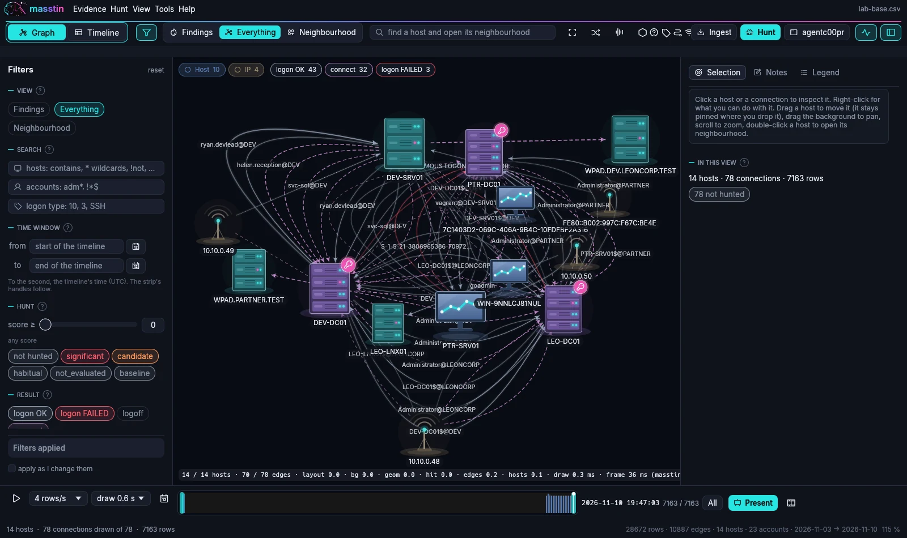

El análisis forense rara vez se hace en el portátil. Se hace en un servidor de análisis al que entras por escritorio remoto, o en una máquina virtual que te deja el cliente dentro de su red. Y ahí las aplicaciones gráficas modernas se arrastran.

El motivo es que no hay tarjeta gráfica. En una sesión RDP, o en una VM sin controlador de GPU, Windows solo ofrece su OpenGL genérico 1.1, demasiado antiguo, y WARP, que es la CPU haciendo de tarjeta gráfica. Y lo hace despacio.

Lo medimos con el [visor](/es/tools/masstin-viewer/) en un servidor de dos núcleos por RDP: con WARP, **155 ms por imagen**. Seis imágenes por segundo con la CPU al 82 %. Así no se puede usar.

## Lo que hace el visor

Antes de abrir la ventana, mira dónde está. Si es una **sesión de escritorio remoto**, o el único adaptador de pantalla es el **básico de Windows**, no intenta usar la GPU: dibuja con un **rasterizador propio, por CPU**. Y lo dice en la consola:

```
Renderer: software, drawn by the CPU (a remote desktop session: no GPU to draw with)
```

No hay que configurar nada ni acordarse de ningún parámetro.

Ese rasterizador está pensado para este tipo de imagen. Recuerda lo que ya ha dibujado y solo repinta las zonas que cambian, usa las instrucciones vectoriales del procesador que encuentre (SSE4.1, AVX2 o NEON) y entrega la imagen al sistema como un mapa de bits normal, que es justo lo que un escritorio remoto transmite bien.

No es todo código nuestro, y hay que decirlo: parte del rasterizador de egui_software_backend, de DGriffin91 (licencia MIT o Apache-2.0), integrado y adaptado dentro de masstin.

## Los números

En el mismo servidor de dos núcleos, por RDP, con un laboratorio de quince máquinas y la ventana a 1460 × 900:

| | WARP | Rasterizador de masstin |
|---|---|---|
| CPU con la ventana quieta | 0 % | 0 % |
| CPU dibujando cada imagen | 82 % | 43 % |
| Imágenes por segundo | 6 | 29 (limitado a 30) |

Casi cinco veces más fluido con la mitad de procesador.

[{: style="display:block; margin: 1rem auto; max-width: 100%;" loading="lazy"}](/assets/images/viewer/r-soft.webp)

Esta captura está hecha forzando el rasterizador por CPU, con el contador de **F1** abajo. Se ve lo mismo que con GPU. Lo que falta son los adornos, y eso es el modo ligero.

## El modo ligero

Cuando dibuja la CPU, el visor apaga solo lo que cuesta y no aporta: el movimiento, el brillo, la rejilla de puntos y el foco del fondo. Lo dice en la línea de estado, y cualquiera de esas cosas se puede volver a encender en View › Style.

En modo ligero nada se anima. La cámara salta en vez de deslizarse, una máquina se ilumina de golpe al pasar el ratón. Y lo más importante: **la ventana solo se repinta cuando algo cambia**. Con la imagen quieta, la CPU está al 0 %. En un servidor compartido con otros analistas, eso se agradece.

El modo ligero también se activa solo con GPU, si el visor ve que va mal: noventa imágenes seguidas por debajo de doce por segundo con el movimiento activado, y lo apaga.

## Elegir a mano

Casi nunca hace falta, pero se puede:

```bash
masstin -a view -f timeline.csv --renderer software
masstin -a view -f timeline.csv --renderer glow
```

`software` funciona en cualquier máquina, Linux y macOS incluidos. Viene bien cuando un controlador gráfico da guerra, que en máquinas virtuales pasa más de lo que debería.

También hay variables de entorno, por si lo lanzas desde un script: `MASSTIN_VIEW_RENDERER` y `MASSTIN_VIEW_LIGHT=1`.

## Saber qué está pasando

**Help › About** dice qué está dibujando la ventana: el renderizador OpenGL y su versión, o el rasterizador por CPU y el juego de instrucciones que usa.

**F1** enseña el coste de cada imagen: el tiempo entre dos imágenes, repartido entre lo que es de masstin y lo que es del dibujo. Mientras está activo mantiene la ventana dibujando para poder medir, así que apágalo al acabar.

Si un día el visor te va lento en un sitio raro, con esas dos cosas basta para saber por qué.
