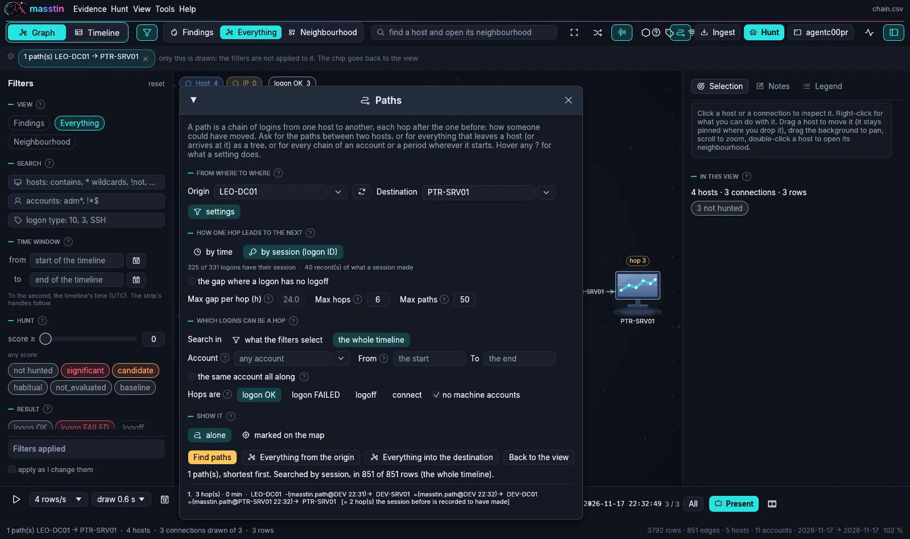

Un camino encontrado por tiempo es una hipótesis. Dice que alguien entró en B a las 22:31 y que alguien salió de B hacia C a las 22:32. Que sea el mismo alguien es cosa tuya.

En un informe eso se nota. «El atacante pudo pasar de B a C» es una frase que cualquier abogado de la otra parte desmonta en una tarde. «La sesión que se abrió en B desde A es la que conectó con C» es otra cosa.

El modo **by session (logon ID)** de [Find path](/es/tools/masstin-viewer-find-path/) busca la segunda frase.

## La idea

Cuando alguien inicia sesión en una máquina Windows, el sistema le da a esa sesión un número: el *logon ID*. Aparece en el 4624 que la abre y en el 4634 o 4647 que la cierra. Todo lo que haga esa sesión mientras tanto lleva ese número.

Así que hay dos maneras de atar un salto al anterior:

1. **La máquina lo dejó escrito.** Hay un registro, en la máquina intermedia, que dice «la sesión con este logon ID conectó con tal sitio».
2. **Encaja en el tiempo de la sesión.** El salto sale de la máquina cuando la sesión ya está abierta y todavía no se ha cerrado.

La primera es una prueba. La segunda es un indicio fuerte, bastante mejor que «en las 24 horas siguientes».

[{: style="display:block; margin: 1rem auto; max-width: 100%;" loading="lazy"}](/assets/images/viewer/p-session.webp)

Debajo del selector, la ventana te dice con qué cuenta para trabajar: `325 of 331 logons have their session · 40 record(s) of what a session made`. Si ese primer número es bajo, es que te faltan los logoffs y el modo va a encontrar poco. Mejor saberlo antes de buscar.

## En Windows: el 4648

El registro que hace de prueba en Windows es el **4648**, «se intentó un inicio de sesión con credenciales explícitas». Se escribe en la máquina de *origen* cuando un proceso se autentica contra otra con un usuario y contraseña dados a mano: un `runas`, un `Enter-PSSession -Credential`, un `net use` con usuario, PsExec con `-u`.

Lo que casi nadie mira del 4648 es su `SubjectLogonId`. Es el logon ID de la sesión cuyo proceso hizo la conexión. El mismo número del 4624 que abrió esa sesión.

Con eso la cadena se cierra sola:

```
4624 en B   logon ID 0x1a2b3c, viene de A        ← alguien entra en B desde A
4648 en B   SubjectLogonId 0x1a2b3c, destino C   ← esa misma sesión conecta con C
4624 en C   viene de B                           ← y entra
```

masstin guarda ese `SubjectLogonId` en la columna `logon_id` de la fila del 4648, y por eso puede emparejarlo.

## Cómo se lee en la lista

```
LEO-DC01 -(masstin.path@DEV 22:31)-> DEV-SRV01
         =(masstin.path@DEV 22:32)=> DEV-DC01
         =(masstin.path@PTR-SRV01 22:32)=> PTR-SRV01
[= 2 hop(s) the session before is recorded to have made]
```

Fíjate en las flechas. El primer salto va con guiones, `-( )->`: es el punto de partida y no hay sesión anterior que lo explique. Los dos siguientes van con iguales, `=( )=>`: la máquina dejó escrito que los hizo la sesión que acababa de entrar.

Esa diferencia tipográfica es deliberada. Cuando copias la cadena a un informe, se ve qué saltos están probados y cuáles son solo coherentes.

## En Linux: auditd y su `ses`

Linux no tiene logon ID, pero auditd tiene algo que hace el mismo papel. Cada login recibe un identificador de sesión, `ses=`, y el kernel lo estampa en todos los registros de todos los procesos que nacen de ahí.

Si la máquina audita la llamada `connect`, cada conexión saliente queda con su `ses`. masstin la convierte en una fila `AUDIT_CONNECT` y la ata al login SSH de esa sesión. El detalle, con la regla que hace falta, está en el [artículo de artefactos de Linux](/es/artifacts/linux-forensic-artifacts/).

Lo probamos en el laboratorio saltando desde una máquina Linux a dos Windows por SMB. La cadena sale con sus iguales. Y la comprobación más convincente fue la contraria: otra sesión SSH abierta a la vez en la misma máquina, que no hizo nada, no produce ningún camino por sesión. Por tiempo sí lo habría producido.

## Cuándo no vas a encontrar nada

Conviene tenerlo claro para no sacar conclusiones de un resultado vacío:

- **El 4648 solo existe con credenciales explícitas.** Un salto que reutiliza el ticket de la sesión (un `dir \\servidor\c$` sin más) no lo genera. Ahí solo queda la prueba del tiempo de sesión.
- **Sin logoffs no hay duración.** Si los 4634 se han rotado o la política no los audita, la sesión no tiene final. Hay una casilla, *the gap where a logon has no logoff*, que en ese caso usa el margen de horas como sustituto, y lo indica.
- **auditd necesita la regla de `connect`.** Sin ella no hay nada que leer.
- **Depende del origen de los datos.** El logon ID del 4648 se lee de los EVTX. Si la timeline viene de un EDR o de un SIEM que no conserva ese campo, la columna llega vacía.

Un camino por sesión que no aparece no demuestra que no hubo movimiento. Uno que sí aparece es de lo más sólido que vas a poder poner en el informe.
