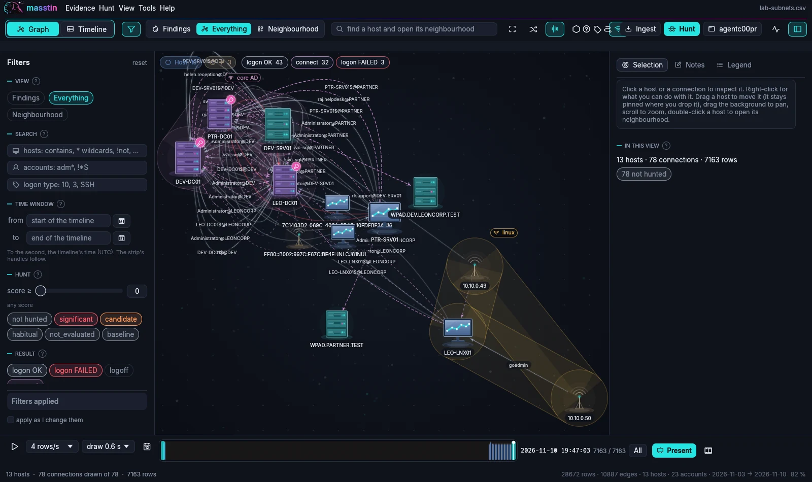

El grafo coloca las máquinas según con quién hablan, no según dónde están. Normalmente es lo que quieres. Pero cuando la pregunta es «¿ha salido de la VLAN de usuarios?» o «¿qué ha tocado en la DMZ?», lo que necesitas ver es el plano de la red.

El botón de la antena en la barra (o **View › Subnet regions**) agrupa las máquinas por subred y dibuja cada grupo como una región de color con su nombre. Es un botón de la barra: no lo confundas con la antena del mapa, que es una dirección IP sin nombre.

[{: style="display:block; margin: 1rem auto; max-width: 100%;" loading="lazy"}](/assets/images/viewer/s-subnets.webp)

Una nota sobre la captura. El laboratorio entero vive en una sola /24, así que agrupado tal cual sería una única región con todo dentro. Para que se vea algo he partido el rango a mano en trozos más pequeños y les he puesto nombre. En una red de verdad no hace falta inventarse nada: las VLAN ya vienen hechas.

## De dónde salen los grupos

Primero, la notación. Un CIDR es una forma de escribir un rango de direcciones: la dirección donde empieza, una barra y cuántos bits son comunes a todo el rango. `10.10.0.0/24` son las 256 direcciones que empiezan por `10.10.0.`; un `/22` es un rango cuatro veces mayor, 1 024 direcciones. Cuanto más pequeño el número tras la barra, más grande el rango.

Los grupos salen de dos sitios:

- **Tus rangos.** En **Tools › Subnets…** escribes los CIDR con un nombre, uno por línea:

  ```
  10.10.0.0/24    servidores VLAN 10
  10.20.0.0/22    puestos de usuario
  192.168.50.0/24 DMZ
  ```

- **Automático.** Con *auto* activado, cualquier otra máquina con dirección conocida cae en el grupo de su /24.

Tus rangos van primero. Lo que no encaje en ninguno va al automático.

## Para qué sirve además de quedar bonito

Las regiones no son solo un fondo. Cada grupo **atrae a sus máquinas y empuja a los demás grupos**, así que el dibujo entero se reorganiza. Lo que se consigue es que las conexiones *entre* subredes queden a la vista, como líneas largas que cruzan de una región a otra.

Y esas son las que importan. Dentro de una VLAN de servidores, que hablen entre ellos es lo de todos los días. Una línea que sale de la región de puestos de usuario y entra directa en la de controladores de dominio por RDP no lo es tanto.

## Hace falta saber la dirección

Una máquina entra en un grupo por las direcciones con las que se la conoce. Y aquí hay una pega: muchos eventos solo traen el nombre.

En la captura se ve. Varias máquinas se han quedado fuera de cualquier región porque la timeline no dice qué dirección tienen. Las que sí están dentro lo están porque antes uní cada nombre con su IP en [Hosts y direcciones](/es/tools/masstin-viewer-hosts-addresses/).

Así que el orden es: primero unir nombres y direcciones, después activar las subredes. Al revés solo verás regiones llenas de antenas.

## Dónde se guarda

Los rangos con nombre se guardan con la timeline (en su fichero de caso, o en `<timeline>.views.json` si no lo hay). Los defines una vez por caso. Qué es el fichero de caso y cuándo se usa cada uno está en [Marcas, notas y fichero de caso](/es/tools/masstin-viewer-marks-case/).
