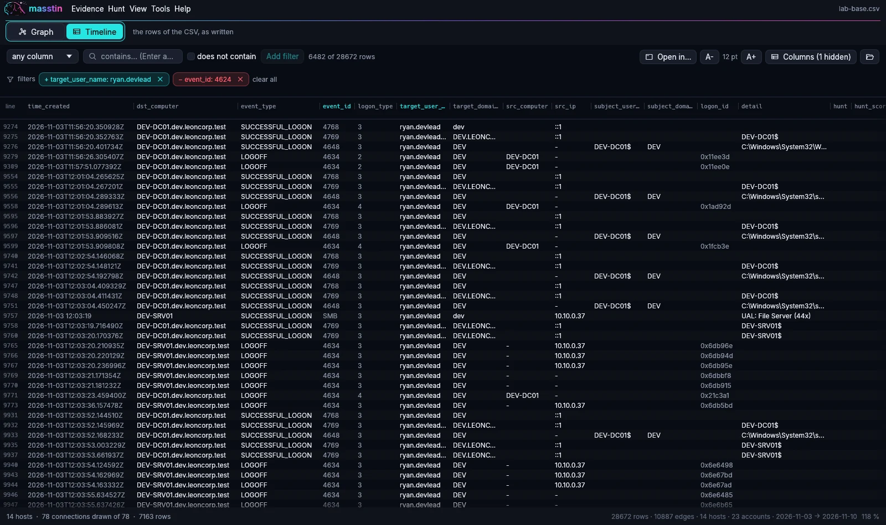

Un grafo es un resumen. Y en forense, antes o después, alguien te pide la fila: el evento exacto, con su hora y su log de origen, que es lo que va al informe.

Por eso el [visor](/es/tools/masstin-viewer/) tiene dos modos en un interruptor arriba a la izquierda. **Graph** es el dibujo. **Timeline** es el mismo fichero, fila a fila.

## Lo que hay

Todas las filas del CSV, también las que no tienen origen y por tanto no salen en el grafo. Las 19 columnas tal como están escritas, de `time_created` a `notes`, en el orden del fichero. Qué guarda cada columna está en [el formato del CSV](/es/tools/masstin-csv-format/). El visor no añade ni cambia nada.

El número de la izquierda es la línea del fichero. La 1 es la cabecera, así que coincide con lo que te enseña cualquier editor. Cuando en el informe pones «línea 10937 de la timeline», quien lo lea la encuentra.

Las filas se dibujan según hacen falta. Un millón se mueven igual que quince.

## Filtrar

Los filtros se suman. Cada uno es «esta columna contiene esto» o «no lo contiene», sin distinguir mayúsculas.

[{: style="display:block; margin: 1rem auto; max-width: 100%;" loading="lazy"}](/assets/images/viewer/tl-filters.webp)

Aquí hay dos: la cuenta contiene `ryan.devlead` y el evento **no** es 4624. Quedan 6 482 filas de 28 672. Se ve la rutina de una cuenta de dominio, evento a evento de Windows:

- el **4768**, cuando la cuenta pide al controlador de dominio su TGT, el ticket Kerberos inicial con el que luego pide los demás;
- los **4769**, uno por cada ticket de servicio: el permiso para entrar en un servicio concreto de otra máquina;
- el **4648**, un uso de credenciales explícitas;
- los **4634**, que cierran sesiones.

Están explicados con más calma en [el log Security](/es/artifacts/security-evtx-lateral-movement/). Y en medio una fila distinta, `SMB` con «UAL: File Server (44x)», que no viene de ningún EVTX sino de la base de datos [UAL](/es/tools/masstin-ual/) del servidor.

Un filtro se puede escribir en tres sitios:

- En la barra: eliges columna (o «cualquiera»), escribes y Enter.
- En el nombre de una columna.
- En una celda, con clic derecho. La caja viene ya con el valor de la celda. Es la forma más cómoda, porque casi siempre quieres «más como esta» o «todo menos esta».

Un texto vacío sobre una columna significa «la columna está vacía». Viene bien para encontrar, por ejemplo, logons sin dirección de origen.

Además está la caja de búsqueda, que mira en toda la fila.

## El aspecto

Cada columna es tan ancha como lo que contiene y ni un píxel más, para que quepa en pantalla todo lo que se pueda de cada fila. **A-** y **A+** cambian el tamaño de la letra y los anchos lo siguen. Los bordes se arrastran, y **Columns** esconde las columnas que no te interesan. En la captura de arriba he escondido `log_filename`.

Todo esto se recuerda entre sesiones. En el fichero no cambia nada.

## De la fila al grafo y vuelta

Los dos modos se llevan el uno al otro, y esta es la parte que más se usa.

**Del grafo a las filas.** Clic derecho en una conexión o en una máquina › *Show its rows in the timeline*. El modo Timeline se abre solo con esas filas, y una ficha dice a qué está acotado.

**De la fila al grafo.** Un clic en una fila pone su conexión en el inspector. Clic derecho › *Show its connection in the graph* te lleva al grafo con esa conexión seleccionada. Si el grafo no la estaba enseñando, por un filtro o por el límite, el visor cambia al vecindario del origen y te lo dice en la línea de estado.

**Solo estas filas.** Con Ctrl + clic o Mayús + clic eliges varias. *Show exactly these rows in the graph* dibuja un grafo solo con ellas: una línea por fila, sin agrupar, digan lo que digan los filtros. Para reconstruir una secuencia concreta que has encontrado leyendo.

Lo mismo se puede pedir desde fuera. Los números son líneas del fichero, los mismos que ves a la izquierda de cada fila:

```bash
masstin -a view -f timeline.csv --rows 12,57,301
```

## Abrir en otro programa

**Open in…** entrega las filas a otro programa: la aplicación de CSV del sistema, las que el visor encuentra instaladas (Excel, LibreOffice Calc, Timeline Explorer, Visual Studio Code, Notepad++…) y cualquiera que añadas tú.

Un detalle bien pensado: si la tabla está acotada, lo que se abre es **una copia de las filas que ves**, con la cabecera del fichero y cada registro byte a byte. Una hoja de cálculo se para en 1 048 576 filas y un caso tiene millones; lo que quieres llevar allí son las doscientas que has encontrado, no el fichero entero.

La copia es una copia. Lo que cambies en ella no vuelve a la timeline.
