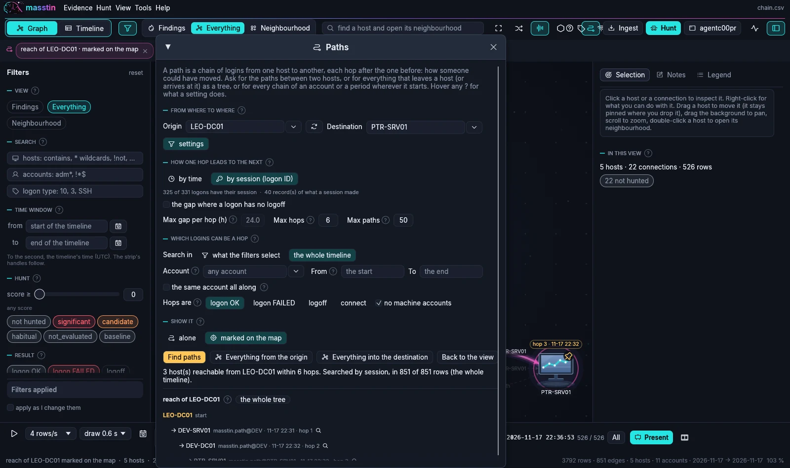
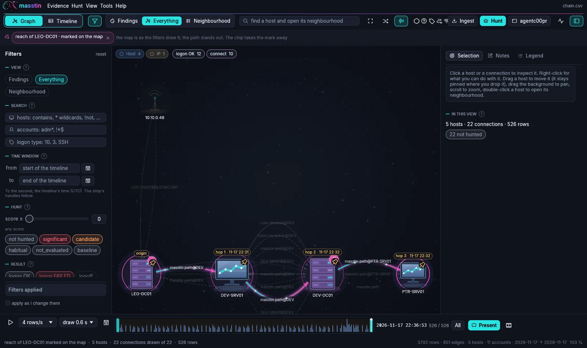

[Find path](/es/tools/masstin-viewer-find-path/) responde cuando sabes los dos extremos. Pero muchas veces solo sabes uno.

Sabes por dónde entró (el portátil del phishing, la VPN de un proveedor) y lo que te piden es el alcance: qué máquinas hay que mirar, cuáles hay que reinstalar, qué le decimos al cliente. O sabes dónde acabó (el servidor con los datos) y lo que hay que averiguar es el punto de entrada.

Para eso están los otros dos botones de **Tools › Paths**.

## Todo lo que sale de un origen

Escribes el origen y pulsas **Everything from the origin**. La caja del destino no se usa para esto: da igual que esté vacía o rellena.

[{: style="display:block; margin: 1rem auto; max-width: 100%;" loading="lazy"}](/assets/images/viewer/p-tree.webp)

En vez de una lista de caminos sale un árbol:

```
LEO-DC01  start
  → DEV-SRV01   masstin.path@DEV · 11-17 22:31 · hop 1
      → DEV-DC01   masstin.path@DEV · 11-17 22:32 · hop 2
          → PTR-SRV01   masstin.path@PTR-SRV01 · 11-17 22:32 · hop 3
```

Cada máquina cuelga de la que la alcanzó **primero**, con la cuenta y la hora de ese salto. Esa es la lectura correcta para acotar un incidente: no «todas las maneras en que pudo llegar», sino «lo antes que pudo estar ahí».

Dos gestos:

- **Pinchas una máquina** del árbol y el mapa te enseña su rama, desde el origen hasta ella.
- **La lupa** de al lado te lista todos los caminos hasta esa máquina, no solo el primero. Es la búsqueda de Find path ya rellenada.

En el mapa, el árbol entero queda marcado con el mismo degradado de cian a magenta, y cada máquina lleva su número de salto.

[{: style="display:block; margin: 1rem auto; max-width: 100%;" loading="lazy"}](/assets/images/viewer/p-tree-map.webp)

## Todo lo que llega a un destino

**Everything into the destination** es lo mismo mirando hacia atrás. Pones la máquina comprometida como destino y el árbol te enseña desde dónde se pudo llegar a ella, salto a salto.

Aquí la hora que se guarda es la *última* posible: lo más tarde que alguien pudo salir de cada máquina y aun así llegar al destino.

Un ejemplo inventado para verlo: si desde una máquina se entró en el destino a las 10:00 y otra vez a las 18:00, el árbol apunta las 18:00. Antes de esa hora todavía se podía salir de ahí y llegar; después, ya no.

Es la hora que sirve para descartar. Si un equipo solo pudo haber iniciado la cadena antes del día 3 y sabes que el día 3 estaba apagado, fuera de la lista.

## Sin origen: seguir a una cuenta

Este modo es el que saca más partido. Las cajas **Account**, **From** y **To** están en la misma ventana Paths, dentro de lo que despliega el botón **settings** (la tabla de ajustes está en [Find path](/es/tools/masstin-viewer-find-path/)). Dejas **vacía** la caja del origen, escribes una cuenta en **Account** y pulsas Everything from the origin.

El árbol arranca entonces en *cada máquina donde esa cuenta empieza a moverse*. Te has enterado de que una cuenta está comprometida y quieres ver todo lo que hizo, sin saber de antemano dónde empezó. Sale completo, con una raíz por cada punto de partida.

Lo mismo vale con fechas en lugar de cuenta: origen vacío, **From** y **To** rellenos, y tienes todas las cadenas que empezaron en ese periodo. Para la noche del incidente, por ejemplo.

## La misma cuenta de principio a fin

La casilla **the same account all along** cambia bastante lo que sale. Sin ella, una cadena puede entrar en una máquina con una cuenta y salir con otra, que es lo que hace un atacante que va robando credenciales. Con ella, cada cadena es de una sola cuenta.

Da juego usarla en dos pasadas. Primero marcada, para ver los movimientos «limpios» de cada cuenta y descartar a los administradores haciendo su trabajo. Después sin marcar, para buscar justo los cambios de cuenta, que es donde suele estar lo interesante.

## Un aviso sobre el tamaño

En una red de verdad, el alcance «por tiempo» desde un controlador de dominio en una ventana de 24 horas es media red. Es cierto y no sirve de nada. Tres maneras de bajarlo:

- Acortar **Max gap per hop** a lo que dure de verdad el incidente.
- Filtrar por cuenta o por fechas.
- Pedir [caminos por sesión](/es/tools/masstin-viewer-session-paths/), que solo siguen los saltos que hizo la sesión anterior.

En una timeline de cinco millones de filas, un árbol tarda menos de un segundo. Se puede probar sin miedo.
