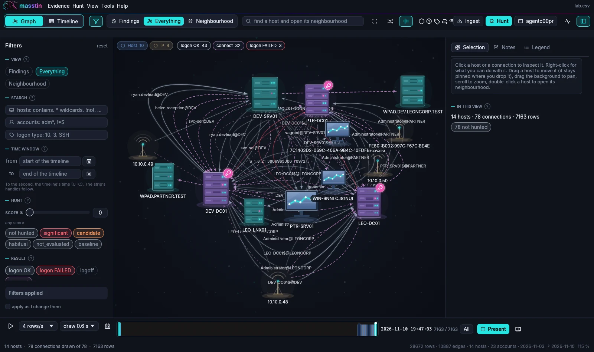
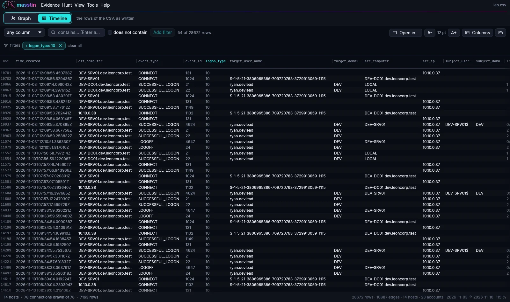

Durante mucho tiempo, ver una timeline de masstin significaba levantar Neo4j o Memgraph, cargarla y escribir Cypher. Funciona, y sigue ahí para quien lo quiera. Pero en mitad de un incidente, con el portátil de guerra y prisa, montar una base de datos de grafos es el paso que casi todo el mundo se salta. Y entonces el grafo no se mira.

Por eso masstin tiene ahora su propia ventana. Lee el CSV tal cual y lo dibuja.

```bash
masstin -a view -f timeline.csv
```

También vale hacer doble clic en el ejecutable, o lanzar `masstin` sin argumentos: se abre una pantalla de bienvenida donde sueltas la evidencia o una timeline ya hecha.

## Lo que se ve

[{: style="display:block; margin: 1rem auto; max-width: 100%;" loading="lazy"}](/assets/images/viewer/v-overview.webp)

Esto es la timeline de nuestro laboratorio: 28 672 filas de una semana, catorce máquinas, 23 cuentas. Tarda medio segundo en abrirse.

Cada máquina se dibuja como lo que es. Un monitor es un puesto de trabajo, un rack es un servidor, el rack con la llave es un controlador de dominio. La antena es una dirección IP de la que la timeline no sabe el nombre. Un globo sería una dirección de fuera de la red.

Las líneas son conexiones, con la cuenta escrita encima. Son más gruesas cuantos más eventos llevan, grises si el logon fue bien, rojas si falló y moradas punteadas si es una conexión sin logon (un 4648, un ticket Kerberos, un RDP que no llegó a autenticar).

La ventana tiene tres zonas alrededor del mapa:

- **A la izquierda, los filtros.** Tres vistas (los hallazgos del hunt, el vecindario de una máquina, o todo), búsqueda por máquina, cuenta y tipo de logon, y la ventana de tiempo.
- **A la derecha, el inspector.** Pinchas una máquina o una conexión y te cuenta lo que hay detrás.
- **Abajo, la franja de tiempo.** Un histograma de toda la timeline con dos asas. Las mueves y el mapa se queda con ese periodo.

## Pinchar para saber

[{: style="display:block; margin: 1rem auto; max-width: 100%;" loading="lazy"}](/assets/images/viewer/v-inspector.webp)

El inspector es donde se pasa el rato. De una máquina te dice con quién habla y con qué cuentas. De una conexión, las filas exactas que la forman y, si has pasado el hunt, por qué le ha parecido rara. Desde ahí saltas a esas filas en la tabla con un clic.

## Y debajo siguen estando las filas

Un grafo resume, y resumir esconde cosas. Por eso el botón **Timeline** de arriba cambia el mapa por la tabla: las 19 columnas del CSV tal como están escritas, con su número de línea.

[{: style="display:block; margin: 1rem auto; max-width: 100%;" loading="lazy"}](/assets/images/viewer/v-timeline.webp)

Aquí he filtrado por `logon_type` 10 y han quedado 54 filas de las 28 672. Se ve entera la huella de una sesión RDP: el 131 de RdpCoreTS cuando llega la conexión, el 1149 cuando se acepta, el 4624 del logon, el 21 y el 22 del gestor de sesiones, y al final el 4647 y el 24 del cierre. Siete u ocho filas de cuatro logs distintos para una sola acción de una persona. Eso es justo lo que el grafo junta en una línea.

Los filtros se suman («contiene», «no contiene», por columna) y la tabla aguanta un millón de filas sin enterarse, porque solo dibuja las que están en pantalla.

## Qué más hay dentro

La ventana ha ido creciendo y cada parte tiene su artículo:

- [Find path: caminos entre dos máquinas](/es/tools/masstin-viewer-find-path/)
- [Árboles: todo lo que sale de un origen o llega a un destino](/es/tools/masstin-viewer-trees/)
- [Caminos por sesión: cuando la máquina deja escrito quién dio el salto](/es/tools/masstin-viewer-session-paths/)
- [Hosts y direcciones: unir el nombre con su IP](/es/tools/masstin-viewer-hosts-addresses/)

## Lo que no hace

No sustituye a una base de datos de grafos si lo que quieres es escribir tus propias consultas: para eso siguen [Neo4j](/es/tools/neo4j-cypher-visualization/) y [Memgraph](/es/tools/memgraph-visualization/). Y no inventa nada. Si una máquina aparece por nombre en unas filas y por IP en otras, verás dos nodos hasta que tú decidas unirlos.

Tampoco necesita tarjeta gráfica. En un servidor por escritorio remoto, que es donde acaba uno muchas veces, dibuja con la CPU y va fluido.
